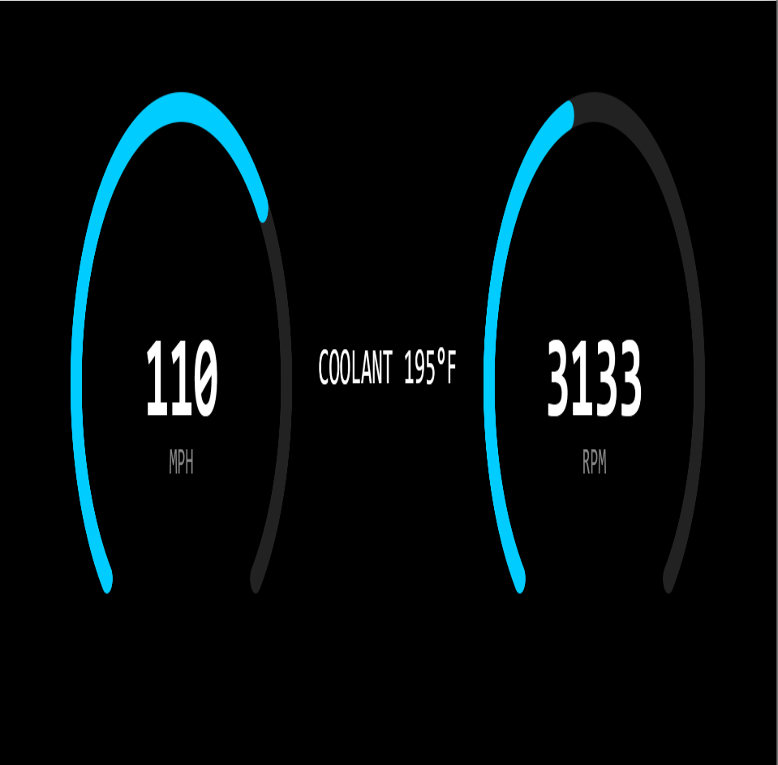
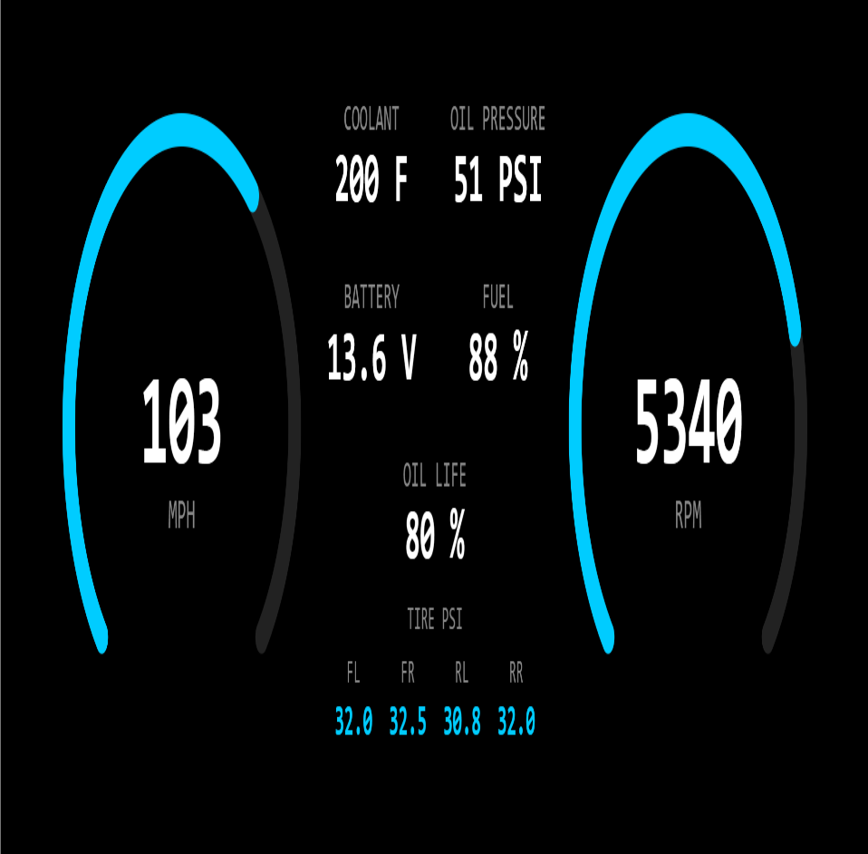
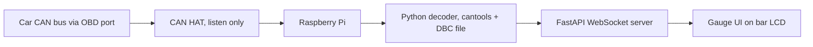

# Charger-R-T-cluster
Custom digital instrument cluster for a 2014 Dodge Charger R/T. Raspberry Pi, CAN bus decoding in Python, and a live gauge UI.

## Progress

### Stage 1: Gauge UI (fake data)

### Stage 1b: More gauges (fake data)
Added coolant, oil pressure, battery, fuel, oil life, and tire pressure.

## Architecture (planned)

